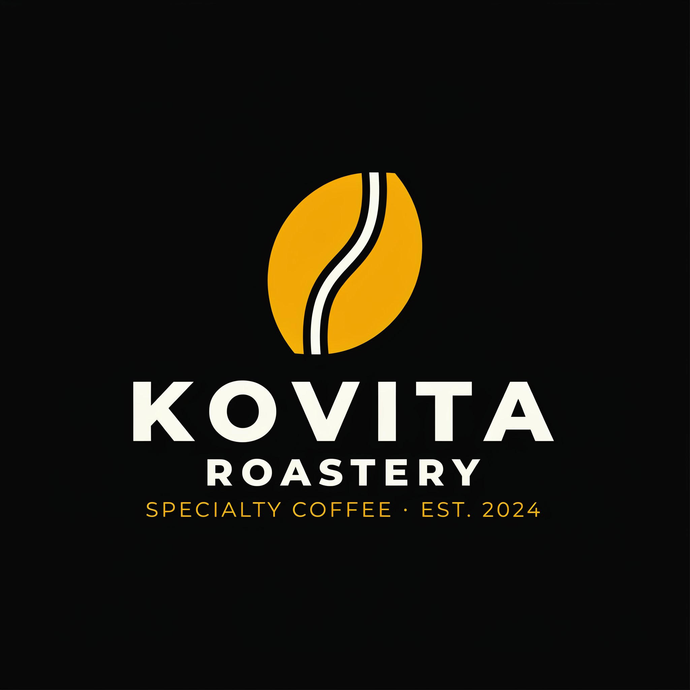
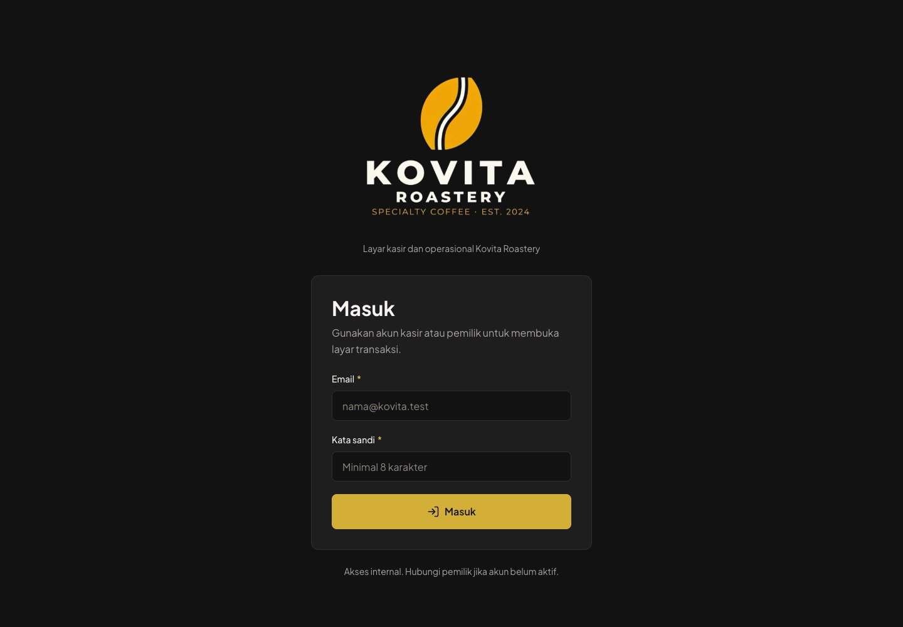
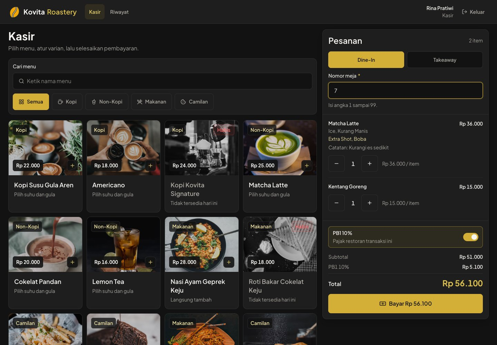
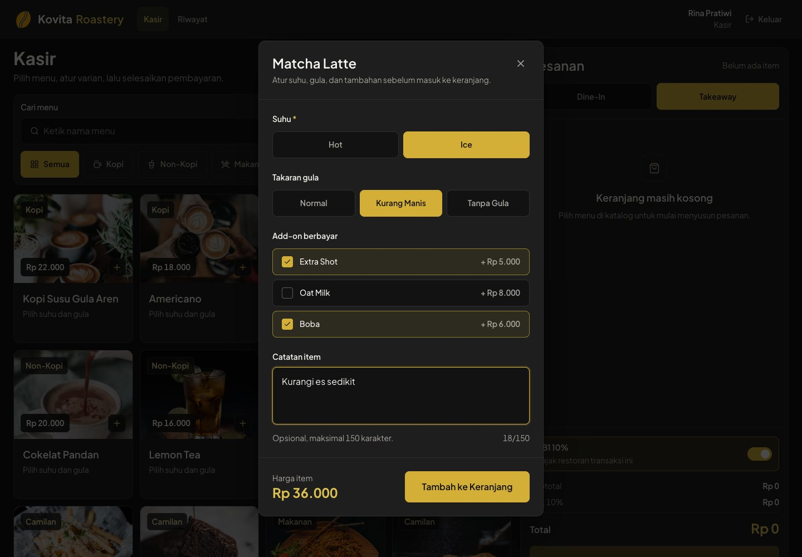
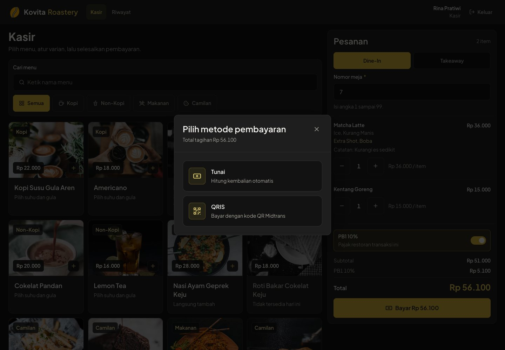
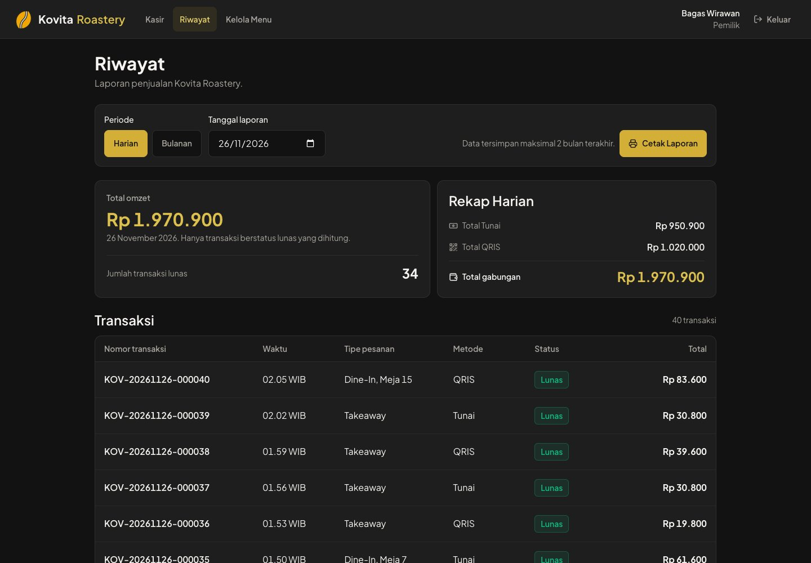
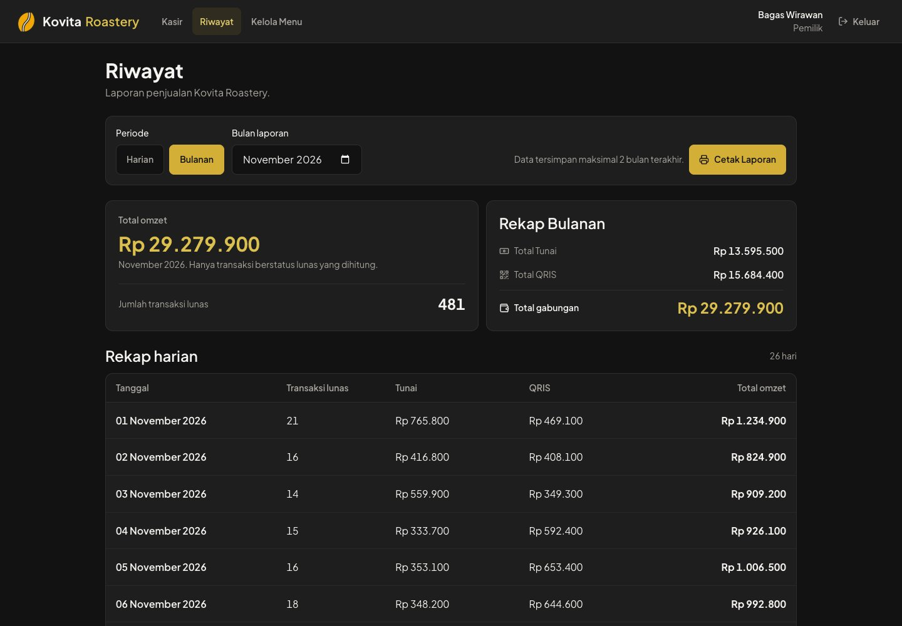
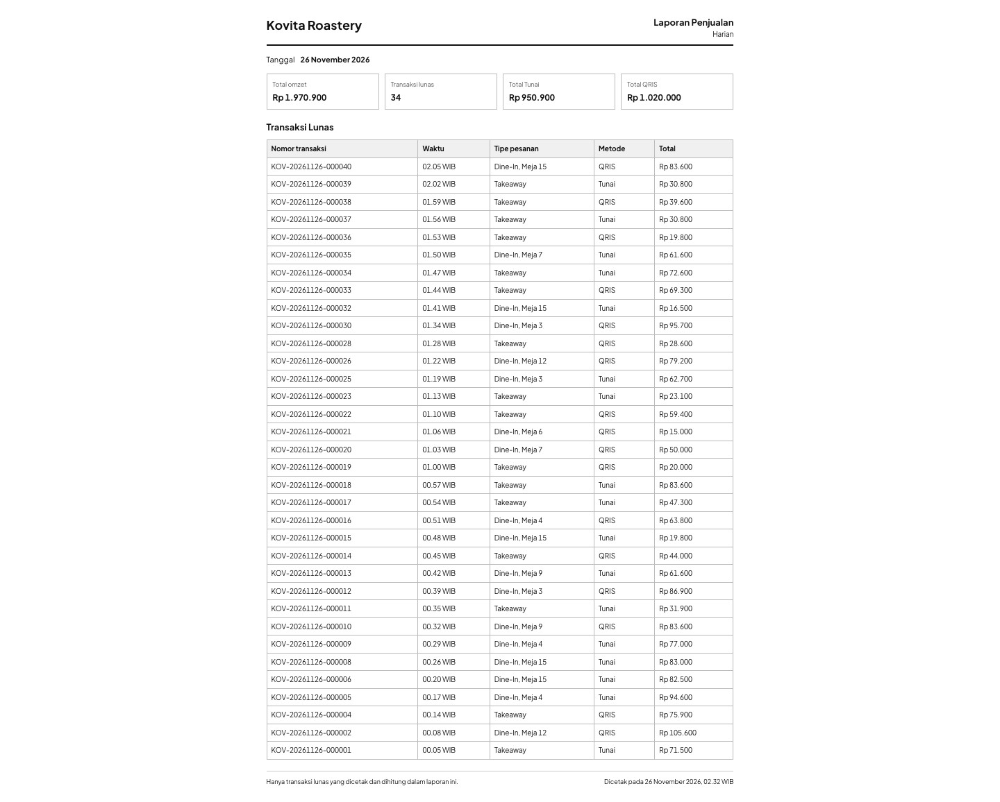
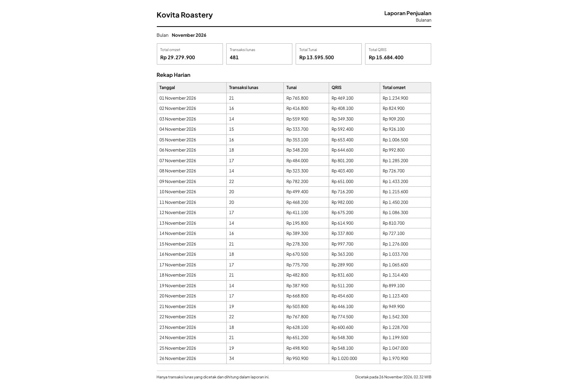
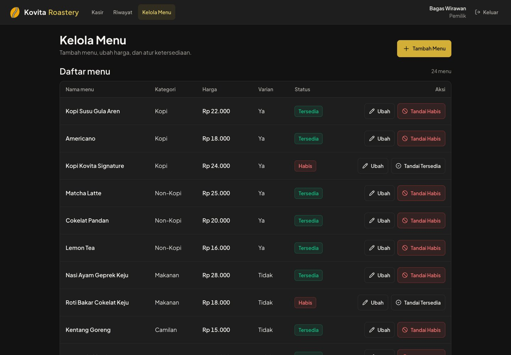

<p align="center">
  
</p>

# Kovita Roastery (Kovita POS)

Kovita Roastery adalah aplikasi kasir berbasis browser untuk cafe yang dirancang dipakai di tablet atau laptop. Aplikasi ini menggabungkan katalog menu, pemilihan varian minuman, keranjang, pembayaran tunai, pembayaran QRIS melalui Midtrans, riwayat transaksi, laporan penjualan harian dan bulanan, rekap kas, dan pengelolaan menu dalam satu alur kerja.

Aplikasi dibangun sebagai dua bagian:

- Frontend React untuk layar kasir.
- Backend Laravel REST API untuk autentikasi, perhitungan transaksi, data menu, riwayat, rekap, dan integrasi Midtrans.

## Daftar Isi

- [Status Proyek](#status-proyek)
- [Fitur Utama](#fitur-utama)
- [Tech Stack](#tech-stack)
- [Akun Demo](#akun-demo)
- [Data Demo](#data-demo)
- [Retensi Data](#retensi-data)
- [Struktur Folder](#struktur-folder)
- [Menjalankan Proyek](#menjalankan-proyek)
- [Penjelasan Halaman](#penjelasan-halaman)
- [Hak Akses](#hak-akses)
- [API](#api)
- [Alur QRIS Midtrans](#alur-qris-midtrans)
- [Database](#database)
- [Testing](#testing)
- [Panduan Deploy](#panduan-deploy)
- [Catatan Keamanan dan Batasan](#catatan-keamanan-dan-batasan)

## Status Proyek

Fitur utama sudah berjalan:

- Login dengan Sanctum token.
- RBAC untuk Kasir dan Pemilik.
- Katalog menu dari database.
- Varian, add-on, catatan item, dan keranjang.
- Pembayaran tunai dengan kalkulasi server.
- QRIS Midtrans dengan polling status.
- Notifikasi Midtrans dengan verifikasi signature.
- Riwayat dua bulan terakhir dan rekap Pemilik.
- Laporan harian dan bulanan dengan tombol cetak.
- Pembersihan otomatis transaksi yang lebih lama dari 2 bulan.
- Kelola menu oleh Pemilik.
- Data penjualan demo dua bulan untuk pengujian tampilan.
- Logo Kovita pada halaman login, header, dan favicon.

Deploy ke hosting atau VPS belum dilakukan. Panduan deploy tersedia di bagian [Panduan Deploy](#panduan-deploy).

## Fitur Utama

### Autentikasi dan Hak Akses

- Login menggunakan email dan kata sandi.
- Token API menggunakan Laravel Sanctum.
- Kata sandi disimpan sebagai hash bcrypt.
- Logout mencabut token yang sedang dipakai.
- Kasir hanya dapat mengakses layar transaksi dan riwayat.
- Pemilik dapat mengakses layar transaksi, riwayat lengkap dengan rekap, dan Kelola Menu.
- Endpoint Kelola Menu dan Rekap diperiksa kembali di server.

### Katalog Menu

- 24 menu dari seeder, terdiri dari 6 menu per kategori.
- Kategori Kopi, Non-Kopi, Makanan, dan Camilan.
- Pencarian instan berdasarkan nama menu.
- Pencarian dan kategori dapat digabung.
- Menu Habis ditampilkan dengan label merah, kartu diredupkan, dan tidak dapat dipesan.
- Foto menu memakai URL gambar dengan fallback kategori jika foto gagal dimuat.

### Varian dan Keranjang

- Suhu Hot atau Ice wajib dipilih untuk menu ber-varian.
- Takaran gula Normal, Kurang Manis, atau Tanpa Gula.
- Add-on berbayar:
  - Extra Shot: Rp 5.000
  - Oat Milk: Rp 8.000
  - Boba: Rp 6.000
- Catatan item maksimal 150 karakter.
- Item dengan varian dan catatan yang sama digabung dalam satu baris.
- Jumlah item maksimal 99.
- Keranjang maksimal 50 baris.
- Tipe pesanan Dine-In atau Takeaway.
- Nomor meja wajib diisi untuk Dine-In dan dibatasi 1 sampai 99.
- PB1 10% dapat dinyalakan atau dimatikan per transaksi.

### Pembayaran

- Tunai dengan nominal cepat Rp 20.000, Rp 50.000, Rp 100.000, atau Uang Pas.
- Kembalian dihitung otomatis.
- QRIS Midtrans dalam mode sandbox atau production sesuai environment.
- Status QRIS diperiksa melalui polling setiap 3 detik.
- Struk siap cetak untuk kertas thermal 58 mm atau 80 mm.
- Transaksi QRIS baru masuk omzet setelah berstatus lunas.

### Riwayat, Laporan, dan Cetak

- Riwayat dihitung menggunakan zona waktu Asia/Jakarta.
- Data tersimpan maksimal 2 bulan terakhir.
- Kasir hanya melihat daftar transaksi hari ini.
- Pemilik dapat memilih laporan Harian atau Bulanan.
- Laporan Harian memakai tanggal dan menampilkan ringkasan serta daftar transaksi.
- Laporan Bulanan memakai bulan dan menampilkan ringkasan serta rekap per hari.
- Pemilik dapat mencetak laporan yang sedang dilihat melalui tombol Cetak Laporan.
- Transaksi pending dan gagal tetap terlihat di daftar harian, tetapi tidak dihitung dalam omzet.
- Laporan cetak hanya memuat transaksi lunas agar total sesuai dengan omzet.

### Kelola Menu

- Tambah menu.
- Ubah harga.
- Tandai menu Habis atau Tersedia.
- Validasi nama 3 sampai 60 karakter.
- Validasi harga Rp 1.000 sampai Rp 1.000.000.
- Perubahan harga tidak mengubah snapshot transaksi lama.
- Tidak ada fitur hapus menu pada versi ini.

## Tech Stack

### Frontend

- React 18.3
- Vite 5.4
- TypeScript
- Tailwind CSS 3.4
- React Router 6
- Zustand
- Axios
- Lucide React
- Plus Jakarta Sans

### Backend

- Laravel 11.57
- PHP 8.2 atau lebih baru
- Laravel Sanctum 4
- MySQL 8.0 atau lebih baru
- Midtrans Core API melalui `midtrans/midtrans-php`

### Port Lokal

Mesin pengembangan ini memakai port berikut karena port 8000 dan 5173 sedang dipakai proyek lain:

- Backend: `http://127.0.0.1:8001`
- Frontend: `http://127.0.0.1:5174`
- Preview build: `http://127.0.0.1:4173`

## Akun Demo

| Peran | Nama | Email | Kata Sandi |
| :--- | :--- | :--- | :--- |
| Kasir | Rina Pratiwi | `kasir@kovita.test` | `kovita123` |
| Pemilik | Bagas Wirawan | `pemilik@kovita.test` | `kovita123` |

Akun dibuat melalui `UserSeeder`.

## Data Demo

Data yang tersedia saat ini:

- 2 akun pengguna.
- 24 menu, terdiri dari 6 Kopi, 6 Non-Kopi, 6 Makanan, dan 6 Camilan.
- 3 add-on.
- 1.130 transaksi demo dalam 62 hari.
- 1.124 transaksi lunas.
- 3 transaksi pending QRIS.
- 3 transaksi gagal QRIS.
- Total omzet demo saat ini Rp 66.611.000.

`DemoTransactionSeeder` mengisi data sebagai berikut:

- Hari ini sampai 2 bulan ke belakang.
- Hari historis mendapat 14 sampai 22 transaksi lunas.
- Hari ini mendapat 40 transaksi dengan campuran status lunas, pending, dan gagal.
- Hari yang sudah memiliki transaksi akan dilewati agar data tidak diduplikasi.
- Seeder hanya dijalankan otomatis saat `APP_ENV=local` melalui `DatabaseSeeder`.
- Jumlah transaksi acak per hari dapat membuat total seed baru sedikit berbeda.

Jalankan seeder transaksi demo secara manual:

```bash
cd backend
php artisan db:seed --class=DemoTransactionSeeder
```

Mengulang seluruh data demo:

```bash
cd backend
php artisan migrate:fresh --seed
```

Perintah `migrate:fresh` menghapus seluruh data lama. Jangan jalankan pada database yang sudah berisi data penting.

Data transaksi pending dan gagal tidak dihitung dalam omzet. Data tersebut ada untuk memperlihatkan variasi status di halaman riwayat.

## Retensi Data

Data transaksi hanya disimpan maksimal 2 bulan.

Transaksi yang lebih lama dari 2 bulan dihapus melalui command:

```bash
cd backend
php artisan transactions:prune
```

Command tersebut dijadwalkan setiap hari pukul 03:00 WIB:

```php
Schedule::command('transactions:prune')->dailyAt('03:00');
```

Agar penghapusan berjalan otomatis, scheduler harus aktif.

Untuk local:

```bash
cd backend
php artisan schedule:work
```

Untuk server production, tambahkan cron:

```cron
* * * * * cd /path/ke/backend && php artisan schedule:run >> /dev/null 2>&1
```

Halaman laporan hanya mengizinkan pemilihan tanggal dan bulan dalam 2 bulan terakhir. API juga menolak periode yang lebih lama.

## Struktur Folder

```text
KovitaRoastery/
  src/                     Frontend React
    components/            Komponen UI, layout, menu, keranjang, pembayaran, laporan
    data/                  Data brand
    hooks/                 Hook kecil seperti judul dokumen
    img/logo/              Logo Kovita
    lib/                   API client, mapper, format, tanggal, perhitungan
    pages/                 Halaman aplikasi
    stores/                State auth, menu, addon, dan keranjang
    types/                 Tipe TypeScript
  public/                  Asset publik frontend, termasuk favicon logo
  docs/screenshots/         Gambar dokumentasi halaman
  backend/                 Laravel 11 REST API
    app/Http/Controllers/  Controller API
    app/Http/Middleware/   Middleware role
    app/Http/Requests/     Validasi request
    app/Http/Resources/    Format respons JSON
    app/Models/            Model Eloquent
    app/Console/Commands/  Command pembersihan data lama
    app/Services/          Logika transaksi dan Midtrans
    database/migrations/   Skema database
    database/seeders/      Seeder akun, menu, add-on, transaksi demo
    routes/api.php         Daftar endpoint API
  dist/                    Hasil build frontend
  README.md
```

Logo asli berada di:

```text
src/img/logo/logo_kovita.jpg
```

Versi turunan yang dipakai di aplikasi:

```text
src/img/logo/logo_kovita_login.png
src/img/logo/logo_kovita_mark.png
public/logo_kovita_mark.png
```

## Menjalankan Proyek

### Prasyarat

- Node.js 18 atau lebih baru.
- PHP 8.2 atau lebih baru.
- Composer.
- MySQL 8.0 atau lebih baru.
- Midtrans Sandbox Server Key untuk menguji QRIS.

### 1. Siapkan Database

```bash
mysql -uroot -e "CREATE DATABASE IF NOT EXISTS kovita_pos CHARACTER SET utf8mb4 COLLATE utf8mb4_unicode_ci;"
```

### 2. Setup Backend

```bash
cd backend
composer install
cp .env.example .env
php artisan key:generate
php artisan migrate:fresh --seed
php artisan serve --host=127.0.0.1 --port=8001
```

Jika `.env` sudah ada, cukup sesuaikan nilai database dan Midtrans. Jangan menimpa kunci rahasia yang sudah diisi.

### 3. Setup Frontend

```bash
cd /Users/wahyu/Documents/my-project/KovitaRoastery
npm install
npm run dev -- --host 127.0.0.1 --port 5174
```

Buka:

```text
http://127.0.0.1:5174
```

### 4. Build Frontend

```bash
npm run build
npm run preview -- --host 127.0.0.1 --port 4173
```

### Variabel Lingkungan Backend

Contoh nilai penting di `backend/.env`:

```env
APP_NAME="Kovita Roastery"
APP_ENV=local
APP_DEBUG=false
APP_TIMEZONE=Asia/Jakarta
APP_URL=http://localhost:8001

DB_CONNECTION=mysql
DB_HOST=127.0.0.1
DB_PORT=3306
DB_DATABASE=kovita_pos
DB_USERNAME=root
DB_PASSWORD=

PB1_RATE=0.10
MIDTRANS_SERVER_KEY=
MIDTRANS_IS_PRODUCTION=false
FRONTEND_URL=http://localhost:5173
```

Untuk QRIS sandbox:

```env
MIDTRANS_SERVER_KEY=isi_server_key_sandbox
MIDTRANS_IS_PRODUCTION=false
```

Untuk production, gunakan server key production dan set:

```env
MIDTRANS_IS_PRODUCTION=true
```

Jangan pernah menaruh `MIDTRANS_SERVER_KEY` di environment frontend.

### Variabel Lingkungan Frontend

File `.env` di root:

```env
VITE_API_BASE_URL=http://127.0.0.1:8001/api
```

## Penjelasan Halaman

### 1. `/login`

Halaman login adalah satu-satunya halaman yang dapat dibuka tanpa sesi.



*Tampilan halaman login.*

Isi halaman:

- Logo Kovita Roastery.
- Form email.
- Form kata sandi.
- Tombol Masuk.
- Pesan error.

Validasi tampilan:

- Email wajib diisi.
- Format email harus valid.
- Email maksimal 120 karakter.
- Kata sandi wajib diisi.
- Kata sandi minimal 8 karakter.

Alur:

1. Pengguna mengisi email dan kata sandi.
2. Frontend mengirim request ke `POST /api/auth/login`.
3. Jika berhasil, token Sanctum dan data pengguna disimpan di session storage.
4. Pengguna diarahkan ke `/kasir`.
5. Jika gagal, tampil pesan “Email atau kata sandi salah”.

Server membatasi percobaan login menjadi 5 kali per menit per alamat IP.

### 2. `/kasir`

Layar transaksi adalah halaman utama kasir.



*Layar kasir dengan katalog, keranjang, dan tipe pesanan.*

Tata letak:

- Panel kiri sekitar 65 persen untuk pencarian, filter kategori, dan katalog menu.
- Panel kanan sekitar 35 persen untuk keranjang yang menempel di sisi kanan.

Panel kiri berisi:

- Kolom pencarian instan.
- Chip kategori Semua, Kopi, Non-Kopi, Makanan, dan Camilan.
- Grid kartu menu 3 kolom pada tablet dan 4 kolom pada laptop.
- Status loading, error, empty, dan hasil pencarian kosong.

Kartu menu berisi:

- Foto menu.
- Kategori.
- Nama menu.
- Harga.
- Label Habis bila menu tidak tersedia.

Saat kartu menu ditekan:

- Menu tanpa varian langsung masuk keranjang.
- Menu ber-varian membuka pop-up kustomisasi.

Pop-up varian berisi:

- Pilihan suhu Hot atau Ice.
- Pilihan takaran gula.
- Add-on berbayar.
- Catatan item.
- Total harga item yang berubah otomatis.
- Tombol Tambah ke Keranjang.



*Pop-up kustomisasi varian dan add-on.*

Panel kanan berisi:

- Daftar item.
- Tombol tambah dan kurangi jumlah.
- Pilihan Dine-In atau Takeaway.
- Nomor meja untuk Dine-In.
- Toggle PB1 10%.
- Subtotal.
- Nominal PB1.
- Total.
- Tombol Bayar.

Modal pembayaran:

- Tunai.
- QRIS.

Pembayaran tunai:

- Total tagihan.
- Input uang diterima.
- Nominal cepat.
- Uang Pas.
- Kembalian otomatis.
- Tombol Selesaikan Pembayaran.



*Modal pemilihan metode pembayaran.*

Pembayaran QRIS:

- Membuat transaksi pending.
- Meminta charge ke Midtrans.
- Menampilkan QR dari Midtrans.
- Menampilkan status Menunggu pembayaran.
- Memeriksa status setiap 3 detik.
- Menampilkan Pembayaran Berhasil atau Pembayaran tidak berhasil.

Setelah pembayaran selesai:

- Modal struk terbuka.
- Struk dapat dicetak.
- Tombol Tutup mengosongkan keranjang.

### 3. `/riwayat`

Halaman riwayat menampilkan transaksi dan laporan penjualan berdasarkan zona waktu Asia/Jakarta.



*Laporan penjualan harian untuk Pemilik.*

Untuk Kasir:

- Hanya daftar transaksi hari ini.
- Tidak ada filter laporan.
- Tidak ada ringkasan omzet.
- Tidak ada rekap kas.
- Tidak ada tombol cetak laporan.

Untuk Pemilik:

- Filter periode Harian atau Bulanan.
- Pemilih tanggal untuk laporan Harian.
- Pemilih bulan untuk laporan Bulanan.
- Total omzet.
- Jumlah transaksi lunas.
- Total Tunai.
- Total QRIS.
- Total gabungan.
- Tombol Cetak Laporan.

Pada mode Harian:

- Tanggal default adalah hari ini.
- Daftar menampilkan seluruh transaksi pada tanggal tersebut, termasuk pending dan gagal.
- Ringkasan hanya menghitung transaksi lunas.
- Tombol Cetak Laporan mencetak laporan penjualan lunas pada tanggal tersebut.

Pada mode Bulanan:

- Bulan default adalah bulan berjalan.
- Ringkasan menghitung seluruh transaksi lunas pada bulan tersebut.
- Daftar menampilkan rekap per hari berisi transaksi lunas, Tunai, QRIS, dan total omzet.
- Tombol Cetak Laporan mencetak laporan bulanan.



*Laporan penjualan bulanan dengan rekap per hari.*

Data maksimal 2 bulan terakhir. Tanggal atau bulan yang lebih lama ditolak oleh API dan dibatasi pada pemilih tanggal.

Laporan cetak berisi:

- Nama brand Kovita Roastery.
- Jenis laporan.
- Tanggal atau bulan laporan.
- Total omzet.
- Jumlah transaksi lunas.
- Total Tunai.
- Total QRIS.
- Daftar transaksi lunas untuk laporan Harian, atau rekap harian untuk laporan Bulanan.
- Waktu cetak.

Cetak memakai dialog print browser dan hanya mencetak area laporan, tanpa header aplikasi dan tombol.



*Contoh hasil cetak laporan harian.*



*Contoh hasil cetak laporan bulanan.*

Status transaksi yang dapat muncul di daftar layar:

- Lunas.
- Pending.
- Gagal.

Hanya transaksi Lunas yang dihitung ke omzet dan laporan cetak.

### 4. `/menu`

Halaman Kelola Menu hanya dapat diakses oleh Pemilik.



*Halaman Kelola Menu dengan 24 menu.*

Isi halaman:

- Tombol Tambah Menu.
- Tabel daftar menu.
- Kolom nama, kategori, harga, varian, status, dan aksi.
- Tombol Ubah untuk mengubah harga.
- Tombol Tandai Habis atau Tandai Tersedia.

Modal Tambah Menu berisi:

- Nama menu.
- Kategori.
- Harga.
- Pilihan memiliki varian.
- Pilihan status Habis.

Modal Ubah Harga berisi:

- Nama menu.
- Input harga baru.

Perubahan menu langsung disimpan ke API. Katalog kasir akan menampilkan data terbaru setelah data dimuat ulang atau setelah state katalog diperbarui.

Jika Kasir membuka `/menu`, sistem mengarahkan kembali ke `/kasir` dan menampilkan pesan akses ditolak.

### 5. Guard Akses dan Tampilan Mobile

Route yang membutuhkan login akan mengarahkan pengguna ke `/login` jika belum memiliki sesi.

Route khusus Pemilik akan menolak Kasir dan mengarahkan kembali ke `/kasir`.

Pada lebar layar di bawah 768 px, aplikasi menampilkan:

```text
Buka aplikasi ini di tablet atau laptop
```

Pesan ini muncul karena layar kasir memerlukan lebar minimum 768 px.

## Hak Akses

| Menu atau Aksi | Tanpa Login | Kasir | Pemilik |
| :--- | :---: | :---: | :---: |
| Halaman Login | Ya | Ya | Ya |
| Layar Kasir | Tidak | Ya | Ya |
| Riwayat transaksi hari ini | Tidak | Ya | Ya |
| Laporan harian dan bulanan | Tidak | Tidak | Ya |
| Cetak laporan penjualan | Tidak | Tidak | Ya |
| Total omzet dan jumlah transaksi | Tidak | Tidak | Ya |
| Rekap Tunai dan QRIS | Tidak | Tidak | Ya |
| Kelola Menu | Tidak | Tidak | Ya |
| Tambah menu | Tidak | Tidak | Ya |
| Ubah harga | Tidak | Tidak | Ya |
| Tandai Habis atau Tersedia | Tidak | Tidak | Ya |

## API

Base URL lokal:

```text
http://127.0.0.1:8001/api
```

Semua endpoint selain login dan notifikasi Midtrans membutuhkan header:

```http
Authorization: Bearer <token>
Accept: application/json
```

### Autentikasi

| Metode | Endpoint | Akses | Keterangan |
| :--- | :--- | :--- | :--- |
| POST | `/auth/login` | Publik | Login dan membuat token |
| POST | `/auth/logout` | Login | Mencabut token aktif |
| GET | `/auth/me` | Login | Data pengguna aktif |

### Katalog

| Metode | Endpoint | Akses | Keterangan |
| :--- | :--- | :--- | :--- |
| GET | `/menu` | Kasir, Pemilik | Daftar menu |
| GET | `/addons` | Kasir, Pemilik | Daftar add-on |

### Transaksi

| Metode | Endpoint | Akses | Keterangan |
| :--- | :--- | :--- | :--- |
| POST | `/transaksi` | Kasir, Pemilik | Transaksi tunai atau QRIS |
| GET | `/transaksi/hari-ini` | Kasir, Pemilik | Riwayat hari ini |
| GET | `/transaksi/{id}/status` | Login | Cek dan sinkronkan status QRIS |

### Rekap

| Metode | Endpoint | Akses | Keterangan |
| :--- | :--- | :--- | :--- |
| GET | `/rekap/harian` | Pemilik | Omzet, jumlah transaksi, Tunai, QRIS |
| GET | `/laporan/penjualan?periode=harian&tanggal=YYYY-MM-DD` | Pemilik | Laporan harian |
| GET | `/laporan/penjualan?periode=bulanan&bulan=YYYY-MM` | Pemilik | Laporan bulanan |

### Kelola Menu

| Metode | Endpoint | Akses | Keterangan |
| :--- | :--- | :--- | :--- |
| POST | `/menu` | Pemilik | Tambah menu |
| PATCH | `/menu/{id}` | Pemilik | Ubah nama, kategori, harga, atau varian |
| PATCH | `/menu/{id}/status` | Pemilik | Ubah status Habis |

### Midtrans

| Metode | Endpoint | Akses | Keterangan |
| :--- | :--- | :--- | :--- |
| POST | `/midtrans/notification` | Publik dengan signature | Notifikasi status pembayaran Midtrans |

## Alur QRIS Midtrans

1. Kasir memilih QRIS.
2. Frontend memanggil `POST /api/transaksi` dengan `metode_bayar=qris`.
3. Server:
   - Menghitung ulang harga.
   - Memeriksa status Habis.
   - Membuat transaksi pending.
   - Membuat order ID `KOV-YYYYMMDD-NNNNNN`.
   - Memanggil Midtrans Core API dengan `payment_type=qris`.
   - Menyimpan `midtrans_transaction_id`, `midtrans_payment_type`, dan `midtrans_status`.
4. Frontend menampilkan QR dari Midtrans.
5. Browser memanggil `GET /api/transaksi/{id}/status` setiap 3 detik.
6. Midtrans juga dapat mengirim notifikasi ke:

```text
https://domain-anda/api/midtrans/notification
```

7. Signature notifikasi diverifikasi dengan SHA512:

```text
order_id + status_code + gross_amount + MIDTRANS_SERVER_KEY
```

8. Status Midtrans dipetakan ke status aplikasi:
   - `settlement` dan `capture`: `paid`
   - `pending`: `pending`
   - `deny`, `cancel`, `expire`, `failure`: `failed`

Pada pengembangan lokal, notifikasi Midtrans tidak dapat menjangkau `127.0.0.1`. Selama modal QRIS terbuka, polling status akan tetap memperbarui transaksi. Untuk produksi, URL notifikasi wajib dapat diakses publik melalui HTTPS dan didaftarkan di dashboard Midtrans.

## Database

Tabel utama:

- `users`
- `menu_items`
- `addons`
- `transactions`
- `transaction_items`
- `transaction_item_addons`
- `personal_access_tokens`

Catatan data:

- Harga dan nama menu disimpan sebagai snapshot di item transaksi.
- Subtotal item dihitung dari harga satuan ditambah add-on, dikali jumlah.
- Hanya transaksi `paid` yang masuk omzet.
- `nomor_meja` bernilai null untuk Takeaway.
- Total dan PB1 dihitung ulang di server.

## Testing

Perintah frontend:

```bash
npm run typecheck
npm run build
```

Perintah backend:

```bash
cd backend
php artisan test
```

Pengujian yang sudah dilakukan:

- Login berhasil dan gagal.
- Percobaan login berlebih menghasilkan HTTP 429.
- Token yang sudah logout tidak dapat dipakai lagi.
- Kasir mendapat HTTP 403 saat membuka endpoint Pemilik.
- Transaksi tunai dihitung ulang di server.
- Menu Habis ditolak.
- Harga transaksi lama tidak berubah setelah harga menu diubah.
- QRIS pending tidak masuk omzet.
- QRIS settlement masuk omzet dan rekap QRIS.
- Signature notifikasi valid dan tidak valid.
- Polling status QRIS.
- UI QRIS berhasil dan gagal.
- Responsif pada lebar 768 px.
- Laporan harian dan bulanan.
- Tombol cetak laporan harian dan bulanan.
- Pembersihan transaksi lebih dari 2 bulan.
- RBAC untuk endpoint laporan.
- Pemeriksaan aksesibilitas dengan Axe pada layar utama.

PHPUnit menggunakan SQLite in-memory melalui `phpunit.xml`, sehingga pengujian tidak menghapus database MySQL utama.

## Panduan Deploy

Langkah build lokal:

```bash
npm run build
cd backend
composer install --no-dev --optimize-autoloader
php artisan config:cache
php artisan route:cache
```

Konfigurasi production backend:

```env
APP_ENV=production
APP_DEBUG=false
APP_URL=https://api.domain-anda.com
FRONTEND_URL=https://domain-anda.com
MIDTRANS_IS_PRODUCTION=true
MIDTRANS_SERVER_KEY=server_key_production
```

Konfigurasi production frontend:

```env
VITE_API_BASE_URL=https://api.domain-anda.com/api
```

Langkah deploy yang perlu dilakukan:

1. Siapkan VPS atau hosting PHP 8.2+ dan MySQL 8.0+.
2. Aktifkan HTTPS untuk frontend dan backend.
3. Jalankan migration dan seeder awal.
4. Build frontend dan unggah folder `dist`.
5. Arahkan domain frontend ke hasil build.
6. Arahkan domain backend ke folder `backend/public`.
7. Set `APP_KEY` production.
8. Set CORS `FRONTEND_URL`.
9. Daftarkan URL notifikasi di dashboard Midtrans.
10. Jalankan `php artisan config:cache` dan `php artisan route:cache`.
11. Aktifkan cron `php artisan schedule:run` agar pembersihan data 2 bulan berjalan.

Seeder production:

```bash
cd backend
php artisan migrate --force
php artisan db:seed --force
```

Pada `APP_ENV=production`, `DemoTransactionSeeder` tidak dijalankan otomatis. Seeder tersebut hanya berjalan pada environment local.

## Catatan Keamanan dan Batasan

- Jangan commit file `.env` atau server key Midtrans.
- Gunakan HTTPS pada production.
- Login dibatasi 5 percobaan per menit per alamat IP.
- Seluruh endpoint yang membutuhkan login diperiksa dengan Sanctum.
- Endpoint Pemilik dilindungi middleware role di server.
- Harga, total, dan kembalian tidak dipercaya dari browser.
- Catatan item disimpan sebagai plain text.
- QRIS hanya masuk omzet setelah status settlement atau capture.
- Notifikasi Midtrans tanpa signature valid ditolak dengan HTTP 403.
- Verifikasi notifikasi juga membandingkan nominal dengan total transaksi server.
- Pemilihan QRIS pada frontend akan menampilkan pesan error jika server key belum diisi.
- Pengujian QRIS sandbox dengan pembayaran nyata bergantung pada kredensial dan simulator Midtrans.
- Pengujian notifikasi lokal memerlukan URL publik, misalnya tunnel HTTPS.
- Data transaksi lebih lama dari 2 bulan dihapus oleh scheduler. Pastikan cron scheduler aktif di production.
- Laporan cetak menggunakan fitur print browser dan tidak menyimpan file laporan di server.
- Laravel 11 dan React Router 6 dipertahankan sesuai kebutuhan proyek. Keduanya memiliki security advisory yang perlu ditinjau sebelum deploy production jangka panjang.
